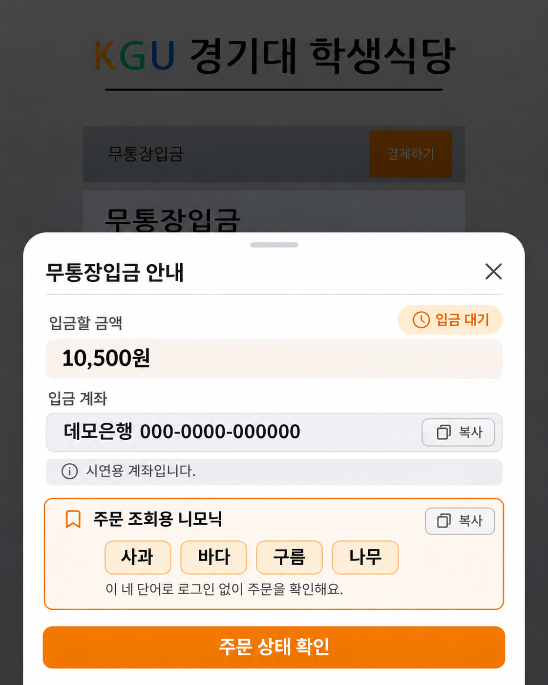
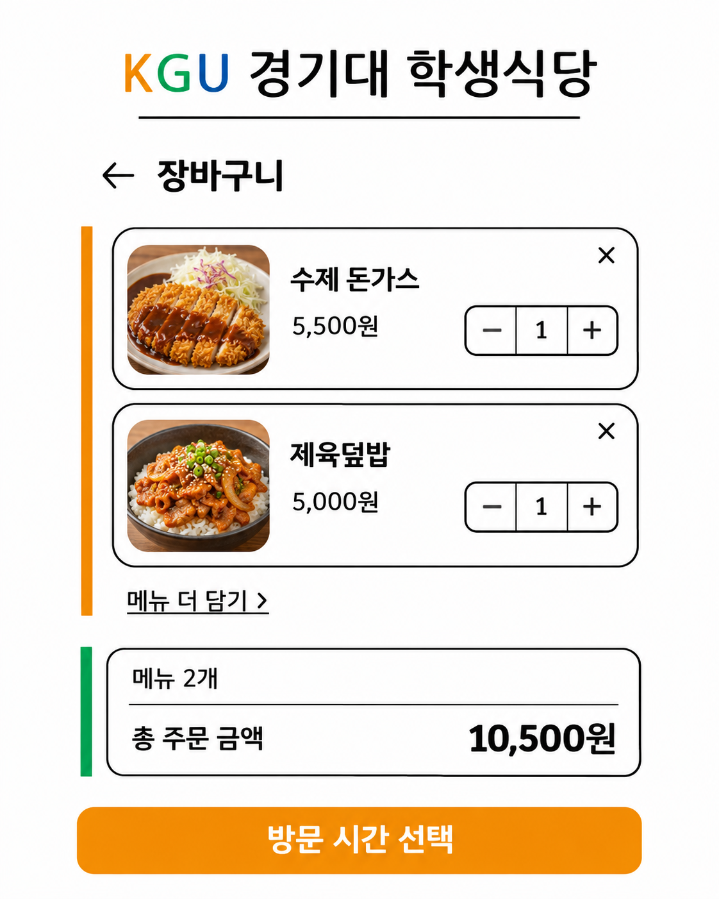

# Programming Basic

프로그래밍기초 D조 팀 프로젝트 **학식당 메뉴 예약 시스템**의 기획 저장소입니다.

점심시간 학생 식당의 주문 대기와 혼잡을 줄이기 위해, 메뉴와 방문 시간을 미리 선택하고 결제한 뒤 시간에 맞춰 픽업하는 서비스를 구상합니다.

## 프로젝트 정보

- 주제: 비트코인 결제 기능을 지원하는 비로그인 학생 식당 예약 앱
- 팀: D조 — 정연성, 남궁성욱, 전승표, 장정우
- 핵심 목표: 다양한 결제수단으로 미리 주문·결제하고, 예약한 시간에 픽업할 수 있도록 합니다.
- 기준 문서: 2026년 11월 20일 최종 계획서

## 주문 흐름

메뉴 확인 → 메뉴·수량 선택 → 장바구니 확인 → 방문 시간 선택 → 총금액·주문 확인 → 결제 수단 선택 → 주문 접수 → 니모닉 발급 → 주문 상태 확인

시간대별 주문 가능 건수를 관리하며, 마감된 시간대는 선택할 수 없습니다. 주문이 접수되면 해당 시간대의 잔여 건수가 1 감소합니다. 방문 시간을 예약하며 별도의 좌석 예약은 포함하지 않습니다.

## 주요 기능

| 구분 | 계획 |
|---|---|
| 매장별 메뉴 | 만권화밥·숑숑돈까스·위델가의 메뉴·가격·사진 표시 |
| 장바구니 | 선택 메뉴와 수량 관리, 총금액 표시 |
| 방문 시간 | 시간대와 남은 주문 가능 건수 조회, 마감 처리 |
| 주문 접수 | 메뉴·수량 검증, 서버 가격으로 금액 계산, 주문 저장 |
| 결제 수단 | 무통장입금·비트코인 입금 안내와 상태 관리 |
| 비로그인 조회 | 주문 접수 시 발급받은 니모닉으로 주문 상태 확인 |

## 화면 시안

최종 계획서에 첨부한 세 화면입니다. 메뉴·가격·입금 정보는 화면 구상을 위한 예시입니다.

| 메뉴 선택 | 무통장입금 안내 | 장바구니 |
|---|---|---|
|  |  |  |

## 계획한 구성

| 영역 | 기술·역할 |
|---|---|
| 정적 백엔드 | Flask, HTML·CSS·JS 등 빌드 파일 제공 |
| 주문 백엔드 | Python, 메뉴·방문 시간·주문·결제 상태 처리 |
| 데이터베이스 | SQLite, 메뉴·방문 시간대·주문·주문 항목·결제 저장 |
| 프론트엔드 | TypeScript, React 및 React Compiler, React Router, Vite |
| 브라우저 상태 | Zustand, Local Storage |

## 백엔드 기능 명세

| 계획서 함수 | 역할 |
|---|---|
| `RoutePing()` | 서버 상태 확인, `Pong` 응답 |
| `RouteBuild()` | 파일 경로 확인 후 빌드 파일 제공 |
| `ReadAllMenus()` | 메뉴 ID·이름·매장·가격·이미지 조회 |
| `ReadAllReservationTargets()` | 방문 시간대·주문 한도·잔여 건수 조회 |
| `MakeOrder()` | 입력 검증, 금액 계산, 주문 저장, 잔여 건수 감소, 니모닉 발급 |
| `UpdatePaymentStatus()` | 결제 대기·성공·실패와 주문 상태 갱신, 중복 반영 방지 |
| `CheckOrder()` | 니모닉으로 주문 상태·방문 시간·결제 안내 조회 |

## 데이터 설계

| 테이블 | 주요 데이터 |
|---|---|
| `Menus` | 메뉴 ID, 메뉴명, 매장명, 가격, 이미지 경로 |
| `ReservationTargets` | 시간대 ID, 시작·종료 시간, 주문 한도, 남은 건수 |
| `Orders` | 주문 ID, 시간대 ID, 니모닉, 총금액, 주문 상태, 접수 시간 |
| `OrderItems` | 주문 ID, 메뉴 ID, 수량, 주문 당시 단가 |
| `Payments` | 결제 ID, 주문 ID, 결제 수단, 금액, 상태, 계좌·주소 안내 |

주문 저장과 잔여 건수 감소를 함께 처리하고, 저장 실패 시 변경을 취소합니다. 니모닉의 고유성을 유지하며, 결제 결과는 중복 반영하지 않도록 설계합니다.

## 상세 계획서

[최종 계획서 전체 내용 보기](docs/계획서.md)

기능별 처리 흐름, 예외처리, 프론트엔드 컴포넌트, 자료형 및 DB 설계를 수록했습니다.
