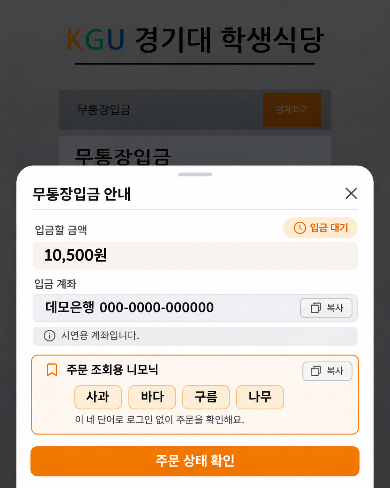
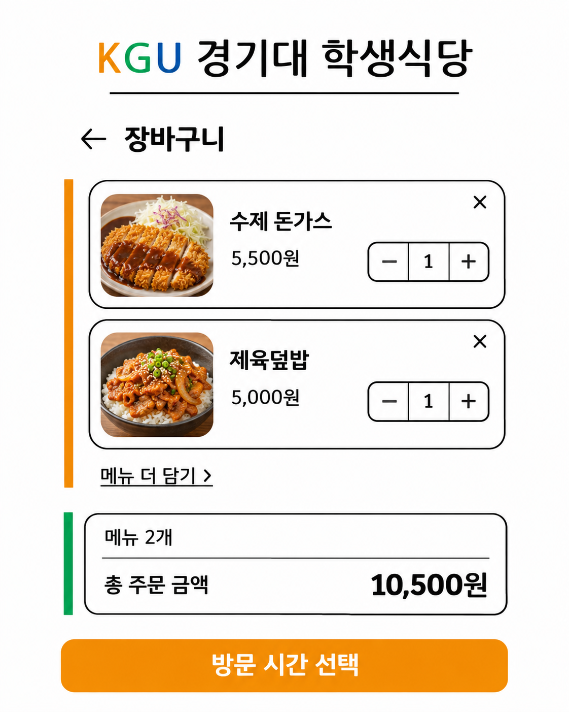

# 학식 주문 앱 최종 계획서

최종 Word 계획서의 내용과 화면 시안을 옮긴 문서입니다.

14주차Team Project 기획 및 발표 계획서

본 양식은 파이썬(Python) 팀 프로젝트의 최종 아이디어를 구체화하고, 프로그램의 세부 처리 로직, GUI/웹 대시보드 UX/UI 디자인 및 핵심 자료구조·DB 설계를 체계적으로 정리하기 위한 통합 서식입니다. 각 항목을 상세히 작성해 주시기 바랍니다.

1. 기본 및 발표 정보

| 항목 1 | 항목 2 |
| --- | --- |
| 발표 일시 | 2026년 11월 20일 (  )시 ~ (  )시 |
| 팀 구성 (조 / 조원) | 제 [D] 조 / 정연성, 남궁성욱, 전승표, 장정우 |
| 프로젝트 주제 | 비트코인 결제 기능을 지원하는 비-로그인(Non-login) 학생 식당 예약 앱 |
| 최종 핵심 목표 | 다양한 결제수단을 사용하여 학식당의 혼잡함 해소를 위해 앱으로 미리 주문, 결제하고 시간에 맞춰 픽업할 수 있도록 한다. |
| 선정된 최종 아이디어 | 주제 비트코인 결제 기능을 지원하는 비-로그인(Non-login) 학생 식당 예약 앱 주제 선정 이유 서버 - 클라이언트 구조: 서버와 클라이언트를 중심으로하여, 기초적인 온라인 서비스의 설계를 연습하기에 적합함. 또한, 팀원 별 역할을 명확히 분리하고 구조화함으로서, 가독성과 유지보수성이 높은 코드를 작성하고자 함. UI/UX 설계 및 다국어 지원: 프론트엔드 라이브러리를 사용하여 사용자 편의에 집중한 서비스를 구상함. 다국어 지원을 통해, 언어가 다른 복수의 사이트를 관리하는 방법을 학습하기에 유리함. 문제 의식 로그인 문제: 학생 식당 예약만을 위해 회원가입과 로그인이라는 진입장벽이 요구됨. 결제 편의성 문제: 구글 플레이처럼 카드를 등록하거나, 인터넷 결제를 사용하는 방식은, 기능을 구현하는 것과 사용자가 직접 사용하는 것 모두에 있어서 시간 낭비를 유발함. 창의성 로그인 문제: 주문 접수 시 주문 조회용 니모닉(Mnemonic)을 발급하여, 로그인 없이도 주문 상태를 확인할 수 있도록 함. 결제 편의성 문제: 무통장 입금 방식을 지원하기 위해 '노력'하되, 비트코인 입금 방식도 지원함. 구분 - 정적 백엔드: HTML, CSS, JS 및 기타 정적 파일을 제공하는 서버 - 주문 백엔드: 메뉴, 방문 시간 예약, 결제 등 실질적인 기능을 구현하는 서버 - 프론트엔드: 유저가 실제로 사용하는 UI/UX 부분을 담당하는 서버 |
| 개발 환경 및 라이브러리 | 정적 백엔드 Flask: REST API를 제공하기 위한 마이크로 백엔드 프레임워크. - 초보자에게 진입장벽이 낮음. - 오픈소스 프레임워크로서 오랫동안 검증됨. - 의존성 주입(DI, Dependency Injection)과 제어의 역전(IoC, Inversion of Control)을 수동으로 연습하기에 용이함. 프론트엔드 Typescript: 자바스크립트에 정적 타입 시스템을 더해 대규모 프론트엔드 코드의 안정성과 유지보수성을 높이는 언어. - 컴파일 타임에 타입 오류를 잡아내어 런타임 버그와 리팩토링 리스크를 줄임. - 에디터 자동완성과 타입 추론이 강력해 협업 및 코드 가독성이 향상됨. - API 응답 스키마나 상태 구조를 명시적으로 모델링해 도메인 경계를 명확함. React Compiler: React 라이브러리에 더해, 컴포넌트와 훅의 메모이제이션을 빌드/컴파일 단계에서 자동으로 최적화해 주는 컴파일러. - 리액트의 컴포넌트(Component) 구조를 통해 가독성과 재사용성이 뛰어난 프로그램을 개발할 수 있음. - 클라이언트 사이드 렌더링(CSR)을 통해서 새로고침 없는 UI/UX를 달성함. - 소수의 파일들만 있으면 앱을 로딩할 수 있으므로, 추후 오프라인 처리나 PWA 기능 추가가 용이함. - 서버 - 클라이언트 구조의 구분이 명확하며, 이에 따라 팀원들이 개발한 REST API를 쉽게 붙일 수 있음. - CDN이나 정적 호스팅 서비스만 사용해도 배포할 수 있으므로 비용 절약됨. - 개발자가 useMemo, useCallback 등을 수동으로 도배하지 않아도 불필요한 리렌더링을 자동으로 줄여줌. React Router: React 라이브러리에서, 전통적인 단일 페이지 앱이 아닌 복수 페이지의 앱을 개발하도록 도와주는 라이브러리. - 브라우저의 히스토리 기능을 사용하여 라우팅하는 원리를 학습하기에 용이함. - 페이지에 따라 라우팅되는 부분과 모든 페이지에서 동일한 부분을 분리하여 다룰 수 있으므로, 재사용성 높은 코드를 작성할 수 있음. Vite: ESBuild를 바탕으로 현대적인 번들링을 지원하는 프론트엔드 빌드 도구. - 개발 환경에서 네이티브 ESM과 빠른 사전 번들링(ESBuild 등)을 활용해 변경 사항을 즉시 반영함. - 프로덕션 빌드 시 최적화된 번들을 생성하며, React Compiler 설정을 자동으로 처리함. - 개발 환경과 프로덕션 환경의 번들링 방식 차이로 인해 일부 레거시 패키지나 특수 플러그인에서 호환성 이슈가 나타나지만, 이번 프로젝트에서는 문제 없음. Local Storage: 브라우저에 Key-value 형태로 데이터를 영구 저장할 수 있는 웹 스토리지 API. - 사용자가 탭이나 브라우저를 닫았다가 다시 열어도 데이터가 유지됨. - API가 직관적이고, 오버엔지니어링 되지 않음 - 최대 수 MB 수준의 용량 제한이 있으나, 이번 프로젝트에서는 문제 없음. Zustand: React 라이브러리에서 훅(Hook) 기반으로 간결하게 전역 상태를 관리할 수 있는 경량 상태 관리 라이브러리. - Context API나 무거운 코드 없이, 직관적으로 상태와 메소드를 정의하고 사용할 수 있음. - 앱의 시작부터 종료까지 유지되어야하는 정보를 직접 저장하고 동기화하는 수고를 덜어줌. |

2. 아이디어 세부 기능 명세 (알고리즘 및 예외처리 중심)

프로그램에서 구현할 핵심 기능들을 작동 단계(Step)별로 나열하고, 데이터 입출력 및 예외처리(try-except 등) 로직을 상세히 설명합니다.
(※ 기능 명세는 프로젝트 진행 상황에 따라 유연하게 추가 및 수정될 수 있습니다.)

| 항목 1 | 항목 2 | 항목 3 |
| --- | --- | --- |
| 정적 백엔드(Static backend) |  |  |
| 기능 구분 (Step) | 세부 기능명 | 기능 상세 설명 (처리 로직 및 예외처리) |
| 헬스 체크(Health Check) | RoutePing 함수의 동작 | 1. 함수가 Flask 서버에 의해 호출됨. 2. 문자열 "Pong"을 제공함. |
| 빌드된 파일 제공 | RouteBuild 함수의 동작 | 1. 함수가 Flask 서버에 의해 호출됨. 2. 정적 컨텐츠가 있는 폴더의 경로와 path 인자를 결합하여 targeted_path (Path 클래스) 생성함. 3. Path.is_file() 함수를 사용하여 실제로 존재하는 파일인지 검증함. 1. 존재하는 파일이라면, 해당 파일을 제공함. 2. 존재하는 파일이 아니라면, 에러 코드를 제공함. |
| 주문 벡엔드(Order backend) |  |  |
| 기능 구분 (Step) | 세부 기능명 | 기능 상세 설명 (처리 로직 및 예외처리) |
| 메뉴 정보 제공 | ReadAllMenus() | 1. 프론트엔드의 메뉴 조회 요청을 받음. 2. 저장된 메뉴 ID, 메뉴명, 매장명, 가격, 이미지 정보를 조회함. 3. 조회한 메뉴 정보를 응답으로 제공함. 4. 조회 중 오류가 발생하면 에러 코드를 제공함. |
| 예약 가능 시간 제공 | ReadAllReservationTargets() | 1. 프론트엔드의 예약 가능 시간 조회 요청을 받음. 2. 시간대별 주문 한도와 남은 주문 가능 건수를 조회함. 3. 예약 시간대 ID, 시작·종료 시간, 주문 한도와 남은 주문 가능 건수를 제공함. 4. 조회 중 오류가 발생하면 에러 코드를 제공함. |
| 주문 접수 | MakeOrder() | 1. 메뉴 ID와 수량, 예약 대상 ID, 결제 수단을 전달받음. 2. 메뉴가 존재하는지와 수량이 1 이상의 정수인지 검증함. 3. 선택한 시간대의 남은 주문 가능 건수가 1 이상인지 확인함. 4. 서버에 저장된 메뉴 가격으로 총금액을 계산함. 5. 주문 저장과 남은 주문 가능 건수의 1 감소를 하나의 트랜잭션으로 처리하고, 주문 조회용 니모닉을 발급함. 6. 니모닉, 조회 정보 만료 시간, 총금액, 결제 수단별 입금 안내를 제공함. 7. 잘못된 입력이나 시간대 마감이면 에러를 제공함. 동시 요청에도 한도를 초과하지 않도록 처리하고, 저장 오류 시 주문과 건수 변경을 함께 취소함. 8. 새 니모닉이 기존 주문과 중복되면 다시 생성함. |
| 결제 상태 관리 | UpdatePaymentStatus() | 1. 주문에 해당하는 결제 결과를 확인함. 2. 결제 대기·성공·실패 상태를 저장함. 3. 결제가 확인되면 주문 상태를 갱신함. 4. 이미 처리한 결제 결과가 다시 전달되면 중복 반영하지 않음. 5. 결제 확인 중 오류가 발생하면 오류를 기록하고 재확인할 수 있도록 처리함. |
| 주문 상태 제공 | CheckOrder() | 1. 프론트엔드에서 주문 조회용 니모닉을 전달받음. 2. 니모닉과 일치하는 주문을 조회함. 3. 주문 상태, 총금액, 방문 시간대와 결제 수단별 입금 안내를 제공함. 4. 일치하는 주문이 없거나 입력 형식이 잘못되면 에러를 제공함. |
| 프론트엔드(Frontend) |  |  |
| 기능 구분(Step) | 세부 기능명 | 기능 상세 설명 (처리 로직 및 예외처리) |
| 홈 화면 표시 | HomePage | 1. 홈 화면을 표시함. 2. 무작위로 선택한 오늘의 명언을 표시함. 3. 메뉴 선택 화면과 주문 확인 화면으로 이동하는 링크를 제공함. |
| 메뉴 조회 및 선택 | MenuPage | 1. MenuAPI.ReadAllMenus()를 호출함. 2. 만권화밥·숑숑돈까스·위델가 탭을 표시하고, 선택한 매장의 메뉴만 표시함. 3. 사용자가 선택한 메뉴와 수량을 전역 상태에 저장함. 4. 선택한 메뉴의 총수량과 총금액을 표시함. 5. 요청 중에는 로딩 문구를 표시하고, 요청 실패 시 오류와 인터넷 연결 확인 문구를 표시함. |
| 장바구니 관리 | CartPage | 1. 전역 상태에 저장된 선택 메뉴와 수량을 표시함. 2. 메뉴를 한 번에 한 개씩 제거할 수 있는 버튼을 제공함. 3. 제거한 결과를 전역 상태에 반영하고 총수량과 총금액을 갱신함. 4. 메뉴 선택 화면과 예약 화면으로 이동하는 링크를 제공함. |
| 방문 시간 선택 | ReservationPage | 1. ReservationAPI.ReadAllReservationTargets()를 호출함. 2. 방문 시간대별 남은 주문 가능 건수를 표시하고, 마감된 시간대는 선택할 수 없도록 함. 3. 사용자가 선택한 예약 대상 ID를 전역 상태에 저장함. 4. 요청 중에는 로딩 문구를 표시하고, 요청 실패 시 오류와 인터넷 연결 확인 문구를 표시함. |
| 결제 수단 선택 및 주문 요청 | OrderPage | 1. 무통장입금 또는 비트코인 중 결제 수단을 선택하도록 함. 2. 전역 상태의 메뉴·수량·예약 대상과 결제 수단을 OrderAPI.MakeOrder()로 전송함. 3. 접수에 성공하면 니모닉과 만료 시간을 Local Storage에 저장함. 4. 주문 확인 화면인 CheckPage로 이동함. 5. 접수에 실패하면 오류를 표시하고 HomePage로 이동함. |
| 주문 상태 확인 | CheckPage | 1. Local Storage에 저장된 니모닉과 만료 시간을 확인함. 2. 저장 정보가 유효하면 OrderAPI.CheckOrder()를 호출함. 3. 전달받은 주문·결제 상태와 총금액을 표시하고, 결제 수단에 따라 입금 계좌 또는 비트코인 주소·금액을 안내함. 4. 저장 정보가 없거나 만료되면 니모닉 수동 입력을 요청함. 5. 조회에 실패하면 오류를 표시하고 저장 정보를 삭제한 뒤 수동 입력을 요청함. |
| 잘못된 주소 안내 | NotFoundPage | 1. 연결된 화면이 없는 주소로 접속하면 오류 화면을 표시함. 2. 홈 화면으로 이동할 수 있는 링크를 제공함. |

3. 각 단계별 상세 UX/UI 디자인 구상

파이썬 GUI(Tkinter/PyQt) 또는 웹 대시보드(Streamlit/Flask) 환경을 기준으로, 위 2번 항목의 기능들이 구현될 주요 화면 인터페이스를 스케치하거나 시안으로 첨부합니다.
(※ 화면 스케치는 별도 용지를 사용할 수 있으며, 버튼·입력창·차트·출력 로그 배치를 명확히 표기해 주세요.)

| 항목 1 | 항목 2 | 항목 3 |
| --- | --- | --- |
|  |  |  |
| (2) 사용하는 컴포넌트들 > 모든 컴포넌트는 Elements, Components, Containers, Pages 폴더 중 하나에 위치해야함. (세부적인 관계는 이후에 다시 설명함.) 폴더들의 논리적 위치는 다음과 같음. src &#124;- api &#124;- assets &#124;- components &#124;- elements &#124;- pages &#124;- containers &#124;- lang &#124;- store &#124;- util 컴포넌트들은 다음과 같음. <UserButton label={...} onClick={...} /> <UserButtonRounded label={...} onClick={...} topRounded={...} bottomRounded={...} /> <UserColoredButton label={...} onClick={...} /> <UserColoredButtonRounded label={...} onClick={...} topRounded={...} bottomRounded={...} /> <UserLink label={...} onClick={...} /> <UserLinkRounded label={...} onClick={...} topRounded={...} bottomRounded={...} /> <UserColoredLink label={...} onClick={...} /> <UserColoredLinkRounded label={...} onClick={...} topRounded={...} bottomRounded={...} /> <UserImage src={...} alt={...} /> <UserImageRounded src={...} alt={...} topRounded={...} bottomRounded={...} /> <Comment label={...} /> <HorizontalFlex> ... </HorizontalFlex> <VerticalFlex> ... </VerticalFlex> <Grid> ... </Grid> <ImageCard title={...} imgSrc={...} imgAlt={...} btnLabel={...} btnOnClick={...} /> <TextCard title={...} btnLabel={...} btnOnClick={...} /> <Logo postLabel={..} /> <Section label={...}> ... </Section> <ColoredSection label={...}> ... </ColoredSection> <NotFound title={...}> ... </NotFound> <UserContainer> ... </UserContainer> <UserNav label={...}> ... </Usernav> <HomePage /> <MenuPage /> <CartPage /> <ReservationPage /> <OrderPage /> <CheckPage /> <NotFoundPage /> | (7) UserButton 컴포넌트의 동작 > Elements 폴더 1. user-btn.css 파일을 import 구문으로 포함함. 2. 상위 컴포넌트에 의해 호출됨. 3. label, onClick 인자를 받아서 스타일을 적용한 HTML 버튼으로 반환함. | (8) UserButtonRounded 컴포넌트의 동작 > Elements 폴더 1. user-btn.css 파일을 import 구문으로 포함함. 2. 상위 컴포넌트에 의해 호출됨. 3. label, onClick, topRounded, bottomRounded 인자를 받아서 스타일을 적용한 HTML 버튼으로 반환함. 4. topRounded가 참이라면, 상단의 모서리를 둥글게 처리함. 5. bottomRounded가 참이라면, 하단 모서리를 둥글게 처리함. |
| (9) UserColoredButton 컴포넌트의 동작 > Elements 폴더 1. user-btn.css 파일을 import 구문으로 포함함. 2. 상위 컴포넌트에 의해 호출됨. 3. label, onClick 인자를 받아서 스타일을 적용한 HTML 버튼으로 반환함. | (10) UserColoredButtonRounded 컴포넌트의 동작 > Elements 폴더 1. user-btn.css 파일을 import 구문으로 포함함. 2. 상위 컴포넌트에 의해 호출됨. 3. label, onClick, topRounded, bottomRounded 인자를 받아서 스타일을 적용한 HTML 버튼으로 반환함. 4. topRounded가 참이라면, 상단의 모서리를 둥글게 처리함. 5. bottomRounded가 참이라면, 하단 모서리를 둥글게 처리함. | (11) UserLink 컴포넌트의 동작 > Elements 폴더 1. user-link.css 파일을 import 구문으로 포함함. 2. 상위 컴포넌트에 의해 호출됨. 3. label, to 인자를 받아서 스타일을 적용한 React Router Link로 반환함. |
| (12) UserLinkRounded 컴포넌트의 동작 > Elements 폴더 1. user-link.css 파일을 import 구문으로 포함함. 2. 상위 컴포넌트에 의해 호출됨. 3. label, to, topRounded, bottomRounded 인자를 받아서 스타일을 적용한 React Router Link로 반환함. 4. topRounded가 참이라면, 상단의 모서리를 둥글게 처리함. 5. bottomRounded가 참이라면, 하단 모서리를 둥글게 처리함. | (13) UserColoredLink 컴포넌트의 동작 > Elements 폴더 1. user-link.css 파일을 import 구문으로 포함함. 2. 상위 컴포넌트에 의해 호출됨. 3. label, to 인자를 받아서 스타일을 적용한 React Router Link로 반환함. | (14) UserColoredLinkRounded 컴포넌트의 동작 > Elements 폴더 1. user-link.css 파일을 import 구문으로 포함함. 2. 상위 컴포넌트에 의해 호출됨. 3. label, to, topRounded, bottomRounded 인자를 받아서 스타일을 적용한 React Router Link로 반환함. 4. topRounded가 참이라면, 상단의 모서리를 둥글게 처리함. 5. bottomRounded가 참이라면, 하단 모서리를 둥글게 처리함. |
| (15) UserImage 컴포넌트의 동작 > Elements 폴더 1. user-img.css 파일을 import 구문으로 포함함. 2. 상위 컴포넌트에 의해 호출됨. 3. src, alt 인자를 받아서 스타일을 적용한 HTML 이미지로 반환함. | (16) UserImageRounded 컴포넌트의 동작 > Elements 폴더 1. user-img.css 파일을 import 구문으로 포함함. 2. 상위 컴포넌트에 의해 호출됨. 3. src, alt, topRounded, bottomRounded 인자를 받아서 스타일을 적용한 HTML 이미지로 반환함. 4. topRounded가 참이라면, 상단의 모서리를 둥글게 처리함. 5. bottomRounded가 참이라면, 하단 모서리를 둥글게 처리함. | 참고: Elements와 Components 폴더의 차이 아래의 요소들은 Elements 폴더 하위에 위치한다. - UserButton - UserButtonRounded - UserColoredButton - UserColoredButtonRounded - UserImage - UserImageRounded - UserLink - UserLinkRounded - UserColoredLink - UserColoredLinkRounded Elements, Containers, Pages 하위의 컴포넌트들을 제외한 컴포넌트들은 모두 Components 폴더 하위에 위치한다. Elements는 자신을 제외한 다른 모든 컴포넌트들로부터 독립적이며, Componets 폴더 하위의 모든 요소들에게 의존될 수 있다. (반대로, Elements 폴더 하위의 요소들은 Components 폴더 하위의 어떤 요소에도 의존할 수 없다.) |
| (17) Comment 컴포넌트의 동작 > Components 폴더 1. comment.css 파일을 import 구문으로 포함함. 2. 상위 컴포넌트에 의해 호출됨. 3. label 인자를 받아서 스타일을 적용한 HTML 요소로 반환함. | (18) HorizontalFlex 컴포넌트의 동작 > Components 폴더 1. horizontal-flex.css 파일을 import 구문으로 포함함. 2. 상위 컴포넌트에 의해 호출됨. 3. 자식 요소(children)를 받아 가로 방향 Flex 레이아웃 스타일이 적용된 컨테이너에 포함하여 반환함. | (19) VerticalFlex 컴포넌트의 동작 > Components 폴더 1. vertical-flex.css 파일을 import 구문으로 포함함. 2. 상위 컴포넌트에 의해 호출됨. 3. 자식 요소(children)를 받아 세로 방향 Flex 레이아웃 스타일이 적용된 컨테이너에 포함하여 반환함. |
| (20) Grid 컴포넌트의 동작 > Components 폴더 1. grid.css 파일을 import 구문으로 포함함. 2. 상위 컴포넌트에 의해 호출됨. 3. 자식 요소(children)를 받아 Grid 레이아웃 스타일이 적용된 컨테이너에 포함하여 반환함. | (21) Section 컴포넌트의 동작 > Components 폴더 1. section.css 파일을 import 구문으로 포함함. 2. 상위 컴포넌트에 의해 호출됨. 3. label과 자식 요소(children)를 받아 스타일이 적용된 섹션 컨테이너에 포함하여 반환함. | (22) ColoredSection 컴포넌트의 동작 > Components 폴더 1. section.css 파일을 import 구문으로 포함함. 2. 상위 컴포넌트에 의해 호출됨. 3. label과 자식 요소(children)를 받아 스타일이 적용된 섹션 컨테이너에 포함하여 반환함. 4. 이때, 사전에 지정된 몇가지 색상 중 하나를 선택하여 지정함. |
| (23) Logo 컴포넌트의 동작 > Components 폴더 1. logo.css 파일을 import 구문으로 포함함. 2. 상위 컴포넌트에 의해 호출됨. 3. postLabel 인자를 받아 스타일이 적용된 로고 요소에 포함하여 반환함. (가능하다면, 로고 바로 뒤에 같은 크기의 문자로 삽입함) 4. 이때, 로고는 경기대학교 로고를 사용함. | (24) TextCard 컴포넌트의 동작 > Components 폴더 1. text-card.css 파일을 import 구문으로 포함함. 2. 상위 컴포넌트에 의해 호출됨. 3. title, btnLabel, btnOnClick 인자를 받아 스타일이 적용된 카드 요소에 포함하여 반환함. 4. 내부적으로 UserColoredButtonRounded를 사용하며, 상단 모서리에는 직선을 적용하고 하단 모서리에는 곡선을 적용함. | (25) ImageCard 컴포넌트의 동작 > Components 폴더 1. image-card.css 파일을 import 구문으로 포함함. 2. 상위 컴포넌트에 의해 호출됨. 3. title, imgSrc, imgAlt, btnLabel, btnOnClick 인자를 받아 스타일이 적용된 카드 요소에 포함하여 반환함. 4. 내부적으로 UserImageRounded를 사용하며, 상단 모서리에는 곡선을 적용하고 하단 모서리에는 직선을 적용함. 5. 내부적으로 UserColoredButtonRounded를 사용하며, 상단 모서리에는 직선을 적용하고 하단 모서리에는 직선을 사용함. 6. ImageCard의 모든 모서리는 내부 요소들의 곡선과 일치하도록 곡선이 설정되어야함. |
| (26) NotFound 컴포넌트의 동작 > Components 폴더 1. not-found.css 파일을 import 구문으로 포함함. 2. 상위 컴포넌트에 의해 호출됨. 3. title과 자식 요소(children)를 받아 스타일이 적용된 컨테이너에 포함하여 반환함. | 참고: Components, Containers, Pages 폴더의 차이 - Components 폴더 하위의 요소들은 Elements 폴더 하위의 요소들에 의존할 수 있지만, Components 폴더의 다른 요소들에 의존해서는 안된다. - Pages 폴더 하위의 요소들은 (페이지를 나타내는 컴포넌트들 이므로), 원칙적으로는 Components 요소들만 의존해야하지만, 이따금씩 모든 페이지에 공통적으로 필요한 요소들이 등장한다. - 그러나 그런 요소들을 Components 폴더 하위에 정의한다면, 상호 의존 금지라는 초기의 규칙을 위반하게 된다. 따라서, 이것을 해결하기 위한 폴더가 Containers 폴더이다. - Containers 폴더는 Pages 폴더 하위에 위치하며, 페이지를 구성하는데 반복적으로 사용되지만, Elements나 Components 폴더 하위의 요소들에 의존해야하는 경우 사용된다. | (27) UserContainer 컴포넌트의 동작 > Containers 폴더 1. user-container 파일을 import 구문으로 포함함. 2. 상위 컴포넌트에 의해 호출됨. 3. 자식 요소(children)를 받아 스타일이 적용된 섹션 컨테이너에 포함하여 반환하되, 컨테이너는 데스크탑에서는 화면의 절반 정도의 폭을 가져야하고, 모바일에서는 화면의 가득 채우는 폭을 가져야한다. |
| (27) UserNav 컴포넌트의 동작 > Containers 폴더 1. Comment 컴포넌트와 user-nav.css 파일을 import 구문으로 포함함. 2. 상위 컴포넌트에 의해 호출됨. 3. label과 자식 요소(children)를 받아 내비게이션 컨테이너(<nav className="nav">)를 반환하며, 내부 정보 영역(nav__info)에 Comment 컴포넌트를 렌더링하고 액션 영역(nav__actions)에 children을 배치함. 4. 데스크탑에서, 내부 정보 영역과 액션 영역은 수평으로 배치되며, 정확히 절반씩 크기를 점유해야한다. 5. 모바일에서, 내부 정보 영역과 액션 영역은 수직으로 배치된다. | (28) HomePage 컴포넌트의 동작 > Pages 폴더 > UI/UX는 참고 A 1. 상위 컴포넌트에 의해 호출됨. 2. UserNav의 nav__info에서 무작위로 선택된 '오늘의 명언'을 출력함. 3. UserNav의 nav__actions에서 CheckPage로 라우트하는 링크와 MenuPage로 라우트하는 링크를 각각 제시함. | (29) MenuPage 컴포넌트의 동작 > Pages 폴더 > UI/UX는 참고 B 1. 상위 컴포넌트에 의해 호출됨. 2. UserNav의 nav__info에서 메뉴의 총 갯수와 총 금액을 표기함. 3. UserNav의 nav__actions에서 HomePage로 라우트하는 링크와 CartPage로 라우트하는 링크를 각각 제시함. 4. MenuAPI에서 ReadAllMenus를 통해 비동기로 로드한 메뉴 정보를 화면에 출력함. 1. 단, 메뉴 데이터의 로드와 출력은 로컬 상태를 사용하며, 메뉴를 선택하는 과정에서만 전역 상태를 사용함. 2. 단, SectionName으로 만권화밥·숑숑돈까스·위델가를 구분하고, 탭 선택은 로컬 상태에 저장함. 선택한 매장의 메뉴를 ColoredSection 내부의 Grid와 ImageCard로 제시함. 3. 단, MenuAPI을 통한 요청이 진행 중인 상황에는 로딩 중 텍스트를 표시함. 4. 단, MenuAPI을 통한 요청이 실패한 상황에는 요청 실패 및 인터넷 확인 텍스트를 표시함. 5. 타입스크립트 fetch() 함수의 then()와 catch()를 사용하여 요청 실패 여부를 확인함. |
| (30) CartPage 컴포넌트의 동작 > Pages 폴더 > UI/UX는 참고 C 1. 상위 컴포넌트에 의해 호출됨. 2. UserNav의 nav__info에서 메뉴의 총 갯수와 총 금액을 표기함. 3. UserNav의 nav__actions에서 MenuPage로 라우트하는 링크와 ReservationPage로 라우트하는 링크를 각각 제시함. 4. 전역 상태를 바탕으로 선택한 모든 메뉴를 나열하며, 메뉴를 '한번에 한개' 제거할 수 있는 버튼을 제공함. 1. 단, 메뉴를 제거한 경우 전역 상태를 업데이트함. | (31) ReservationPage 컴포넌트의 동작 > Pages 폴더 > UI/UX는 참고 D 1. 상위 컴포넌트에 의해 호출됨. 2. UserNav를 사용하지 않음. 3. ReservationAPI에서 ReadAllReservationTargets를 통해 비동기로 로드한 방문 시간대와 남은 주문 가능 건수를 화면에 출력함. 1. 단, 예약 가능 시간대 데이터의 로드와 출력은 로컬 상태를 사용하며, 방문 시간을 선택하는 과정에서만 전역 상태를 사용함. 2. 단, 방문 시간 선택 영역을 ColoredSection으로 구성하고, VerticalFlex와 TextCard로 시간대와 남은 주문 가능 건수를 제시함. 마감된 시간대는 선택을 막음. 3. 단, ReservationAPI을 통한 요청이 진행 중인 상황에는 로딩 중 텍스트를 표시함. 4. 단, ReservationAPI을 통한 요청이 실패한 상황에는 요청 실패 및 인터넷 확인 텍스트를 표시함. 5. 타입스크립트 fetch() 함수의 then()와 catch()를 사용하여 요청 실패 여부를 확인함. 4. 방문 시간이 선택되면 해당 예약 시간대 ID를 전역 상태에 업데이트함. | (32) OrderPage 컴포넌트의 동작 > Pages 폴더 > UI/UX는 참고 E 1. 상위 컴포넌트에 의해 호출됨. 2. UserNav를 사용하지 않음. 3. 사전에 하드코딩된 결제 방법(예: 무통장입금, 비트코인)을 선택하고 OrderAPI의 MakeOrder를 통해 결제를 요청함. (전역 상태를 바탕으로 주문을 접수함) 1. 주문 접수에 성공한다면, 서버가 보내 준 니모닉(Mnemonic)과 조회 정보 만료 시간을 Local Storage에 저장하고, CheckPage로 이동함. 2. 주문 접수에 실패한다면, 에러 메세지를 표시하고 HomePage로 이동함. 3. 타입스크립트 fetch() 함수의 then()와 catch()를 사용하여 요청 실패 여부를 확인함. |
| (33) CheckPage 컴포넌트의 동작 > Pages 폴더 > UI/UX는 참고 F 1. 상위 컴포넌트에 의해 호출됨. 2. UserNav를 사용하지 않음. 3. Local Storage에 저장된 정보를 바탕으로, OrderAPI의 CheckOrder를 통해 주문의 현재 정보를 요청함. 1. 만약 주문 정보를 받는 데 성공한다면, 주문·결제 상태와 총금액을 표시함. 무통장입금은 계좌·입금액을, 비트코인은 주소·BTC 금액을 표시하고 해당 정보로 결제 QR을 생성함. 2. 만약 주문 정보를 받는 데 실패한다면, 에러 메세지를 표시하고 CheckPage로 이동함. (이때, Local Storage 정보는 삭제함.) 4. 만약 Local Storage에 저장된 정보가 만료되었거나, 정보를 찾을 수 없는 경우 수동 입력을 요청함. Local Storage에는 다음과 같은 정보를 저장함. 만약 아래의 5개 키들 중 하나라도 존재하지 않거나, 형식에 맞지 않으면, Local Storage에 저장된 정보가 손상된 것으로 간주함. - m1: 문자열 (마지막으로 수신받은 니모닉의 첫 번째 부분) - m2: 문자열 (마지막으로 수신받은 니모닉의 두 번째 부분) - m3: 문자열 (마지막으로 수신받은 니모닉의 세 번째 부분) - m4: 문자열 (마지막으로 수신받은 니모닉의 네 번째 부분) - exp: 유닉스 타임 (마지막으로 니모닉을 수신한 시간 + 3600초에 해당하는 시간) | (34) NotFoundPage 컴포넌트의 동작 > Pages 폴더 > UI/UX는 참고 G 1. 상위 컴포넌트에 의해 호출됨. 2. UserNav를 사용하지 않음. 3. NotFound 컴포넌트를 통해 HomePage로 이동하는 링크를 제공함. |  |

4. 핵심 변수 및 자료구조·데이터베이스(DB) 설계

파이썬 프로그램 내부에서 데이터를 연산하는 핵심 자료구조(DataFrame, Dict, List, Class, ML 모델 객체)와 데이터베이스(SQLite3/CSV 등) 구조를 명세합니다.

| 항목 1 | 항목 2 | 항목 3 | 항목 4 |
| --- | --- | --- | --- |
| 변수명 / 테이블·컬럼명 | 파이썬 자료형 / 타입 | 사용 모듈 / 함수 | 상세 설명 및 제약조건 |
| OptionOk<T> | { data: T; ok: true; }; | option.ts |  |
| OptionNotOk | { ok: false; }; | option.ts |  |
| Option<T> | OptionOk<T> &#124; OptionNotOk; | option.ts |  |
| MenuID | number; | menu.ts |  |
| MenuName | string; | menu.ts |  |
| MenuPrice | number; | menu.ts |  |
| MenuImageSrc | string; | menu.ts |  |
| MenuImageAlt | string; | menu.ts |  |
| MenuImage | { src: MenuImgSrc; alt: MenuImgAlt; }; | menu.ts |  |
| MenuModel | { id: MenuID; name: MenuName; section: SectionName; price: MenuPrice; image: MenuImage; }; | menu.ts | section으로 메뉴의 소속 매장을 구분함. |
| SectionName | "만권화밥" &#124; "숑숑돈까스" &#124; "위델가"; | menu.ts | 매장명 및 메뉴 선택 탭의 구분값으로 사용함. |
| SectionModel | { name: SectionName; list: Array<MenuModel>; }; | menu.ts |  |
| OrderPassphraseID | number; | order.ts |  |
| OrderPassphrase | { a: OrderPassphraseID, b: OrderPassphraseID, c: OrderPassphraseID, d: OrderPassphraseID }; /* Order making */ | order.ts |  |
| OrderMakingMenuID | MenuID; | order.ts |  |
| OrderMakingMenuQuantity | number; | order.ts |  |
| OrderMakingMenuPair | { id: OrderMakingMenuID; quantity: OrderMakingMenuQuantity; }; | order.ts |  |
| OrderMakingReservationID | ReservationID; | order.ts |  |
| OrderMakingPaymentMethodTransferID | 0; | order.ts |  |
| OrderMakingPaymentMethodTransferBody | { wantFailed: boolean }; | order.ts |  |
| OrderMakingPaymentMethodTransfer | { id: OrderMakingPaymentMethodTransferID; body: OrderMakingPaymentMethodTransferBody; }; | order.ts |  |
| OrderMakingPaymentMethodBitcoinID | 1; | order.ts |  |
| OrderMakingPaymentMethodBitcoin | { id: OrderMakingPaymentMethodBitcoinID; }; | order.ts |  |
| OrderMakingPaymentMethod | OrderMakingPaymentMethodTransfer &#124; OrderMakingPaymentMethodBitcoin; | order.ts |  |
| OrderMakingSendModel | { menus: Array<OrderMakingMenuPair>; reservation: OrderMakingReservationID; paymentMethod: OrderMakingPaymentMethod; }; | order.ts |  |
| OrderMakingReceiveTransferBody | { id: 0; catchDeposit: string; amount: number; }; | order.ts | catchDeposit은 은행명·계좌번호·예금주를 포함한 입금 안내, amount는 원화 입금액. |
| OrderMakingReceiveBitcoinBody | { id: 1; catchAddress: string; amountBTC: string; }; | order.ts | catchAddress는 입금 주소, amountBTC는 정밀도 유지를 위한 문자열 BTC 금액. 주소와 금액으로 결제 QR을 생성함. |
| OrderMakingReceiveBody | OrderMakingReceiveTransferBody &#124; OrderMakingReceiveBitcoinBody; | order.ts |  |
| OrderMakingReceiveModel | { passphrase: OrderPassphrase; totalPrice: number; expiresAt: number; payment: OrderMakingReceiveBody; }; | order.ts | 주문 접수 결과. expiresAt은 주문 조회 정보의 유닉스 만료 시간이며, payment.id로 안내 형식을 구분함. |
| OrderStatusID | number; | order.ts |  |
| OrderCheckSendModel | { passphrase: OrderPassphrase; }; | order.ts |  |
| OrderCheckReceiveModel | { status: OrderStatusID; totalPrice: number; reservation: ReservationTargetModel; payment: OrderMakingReceiveBody & { status: number; }; }; | order.ts | 주문 재조회 시에도 방문 시간·금액·입금 안내와 결제 상태를 복원할 수 있도록 제공함. 결제 상태: 0 대기, 1 성공, 2 실패. |
| ReservationID | number; | reservation.ts |  |
| ReservationStartTime | string; | reservation.ts | 날짜를 포함한 ISO 8601 형식의 방문 시작 시간. |
| ReservationEndTime | string; | reservation.ts | 날짜를 포함한 ISO 8601 형식의 방문 종료 시간. |
| ReservationCapacity | number; | reservation.ts | 시간대별 최대 주문 가능 건수. 1 이상의 정수. |
| ReservationRemaining | number; | reservation.ts | 시간대별 남은 주문 가능 건수. 0 이상이며 주문 한도 이하인 정수. |
| ReservationTargetModel | { id: ReservationID; startTime: ReservationStartTime; endTime: ReservationEndTime; capacity: ReservationCapacity; remaining: ReservationRemaining; }; | reservation.ts | 방문 시간대와 주문 가능 건수를 관리함. remaining이 0이면 마감. |
| ReservationListModel | { list: Array<ReservationTargetModel>; }; | reservation.ts |  |
| Menus | {   menu_id: INTEGER;   name: TEXT;   section_name: TEXT;   price: INTEGER;   image_path: TEXT; } | ReadAllMenus() | 메뉴 ID, 메뉴명, 매장명, 가격, 이미지 경로를 저장함. 매장명은 만권화밥·숑숑돈까스·위델가 중 하나이며, 메뉴 ID는 고유하고 가격은 0보다 큰 정수임. |
| ReservationTargets | {   reservation_id: INTEGER;   start_time: TEXT;   end_time: TEXT;   capacity: INTEGER;   remaining: INTEGER; } | ReadAllReservationTargets() | 방문 시간대 ID, 시작·종료 시간, 주문 한도와 남은 주문 가능 건수를 저장함. 0 ≤ remaining ≤ capacity를 유지하고, 주문 저장과 건수 감소를 하나의 트랜잭션으로 처리함. |
| Orders | { order_id: INTEGER; reservation_id: INTEGER; passphrase: TEXT; total_price: INTEGER; order_status: INTEGER; created_at: TEXT; } | MakeOrder(), CheckOrder() | 주문 ID, 예약 대상 ID, 니모닉, 총금액, 주문 상태, 접수 시간을 저장함. 주문 ID와 니모닉은 고유하며 총금액은 서버에서 계산함. |
| OrderItems | { order_id: INTEGER; menu_id: INTEGER; quantity: INTEGER; unit_price: INTEGER; } | MakeOrder() | 주문 ID, 메뉴 ID, 수량, 주문 당시 개당 가격을 저장함. 한 주문에 여러 메뉴를 연결하며 수량은 1 이상의 정수로 설정함. |
| Payments | {   payment_id: INTEGER;   order_id: INTEGER;   payment_method: INTEGER;   amount: INTEGER;   payment_status: INTEGER;   catch_deposit: TEXT;   catch_address: TEXT;   amount_btc: TEXT; } | MakeOrder(), CheckOrder(), UpdatePaymentStatus() | 결제 수단: 0 무통장입금, 1 비트코인. 상태: 0 대기, 1 성공, 2 실패. amount는 원화 정수, BTC 금액은 문자열로 저장함. 미사용 입금 안내는 NULL이며 결제 결과를 중복 반영하지 않음. |
